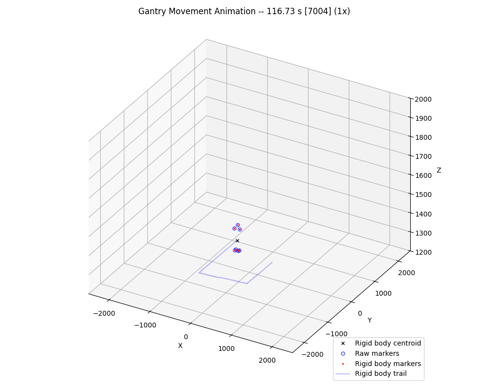
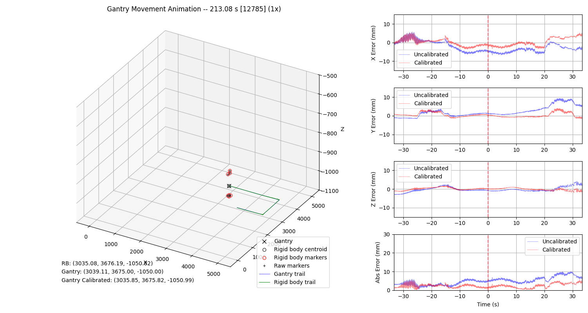
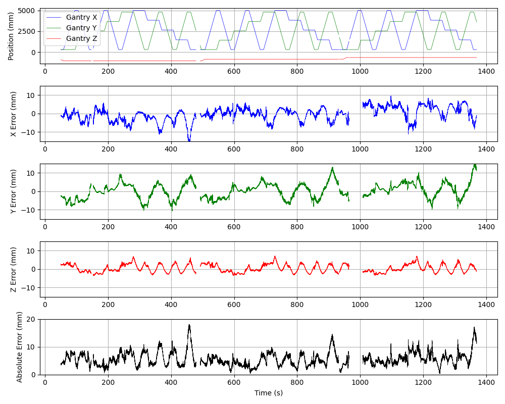
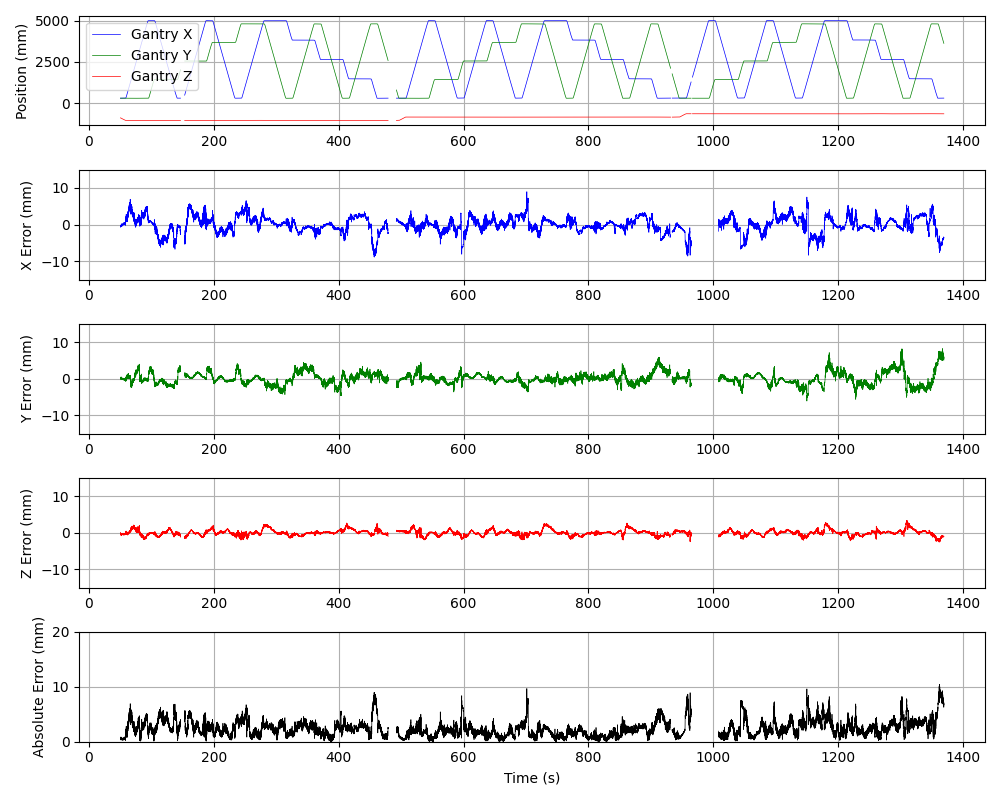
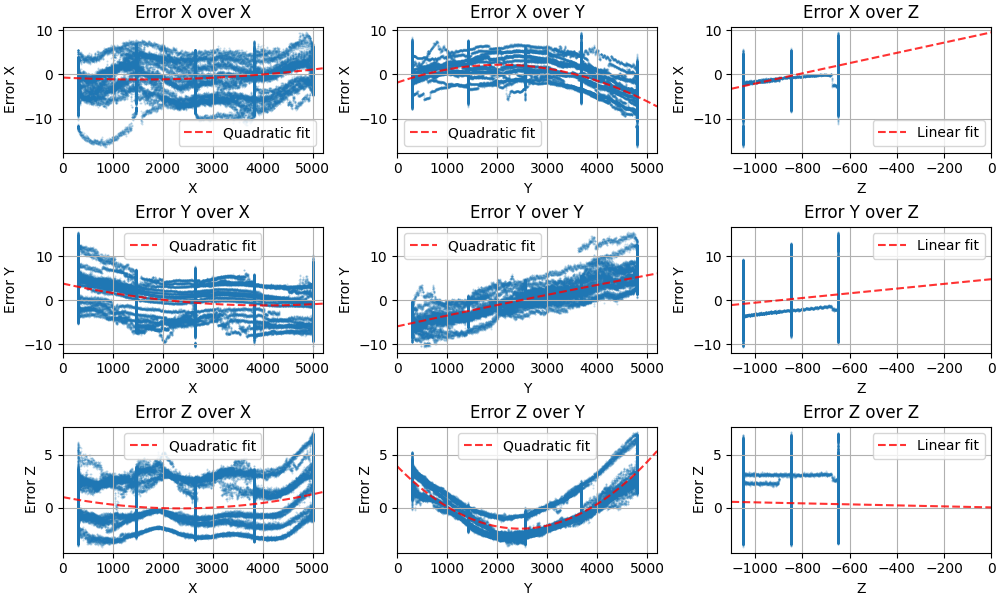
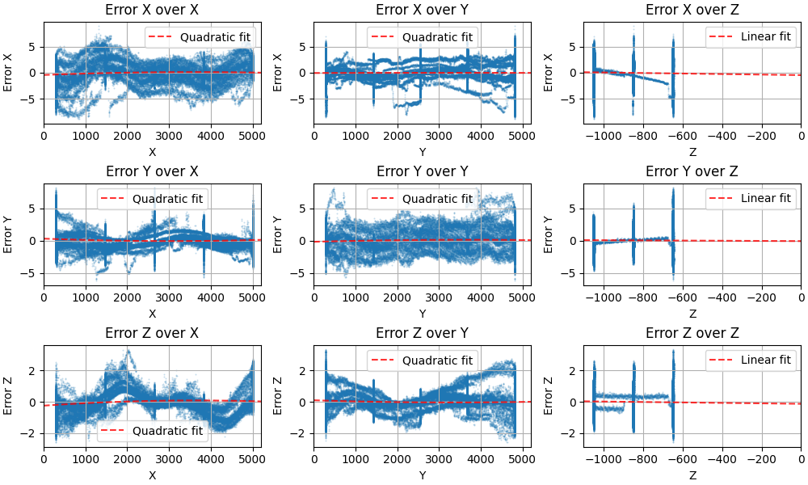
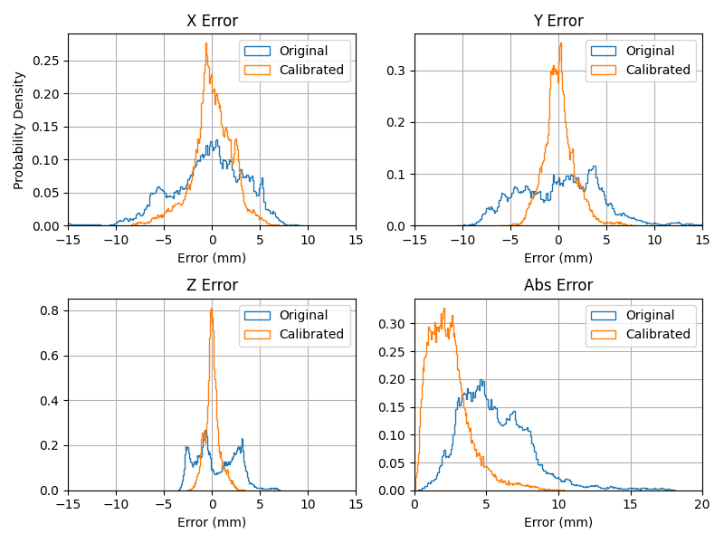
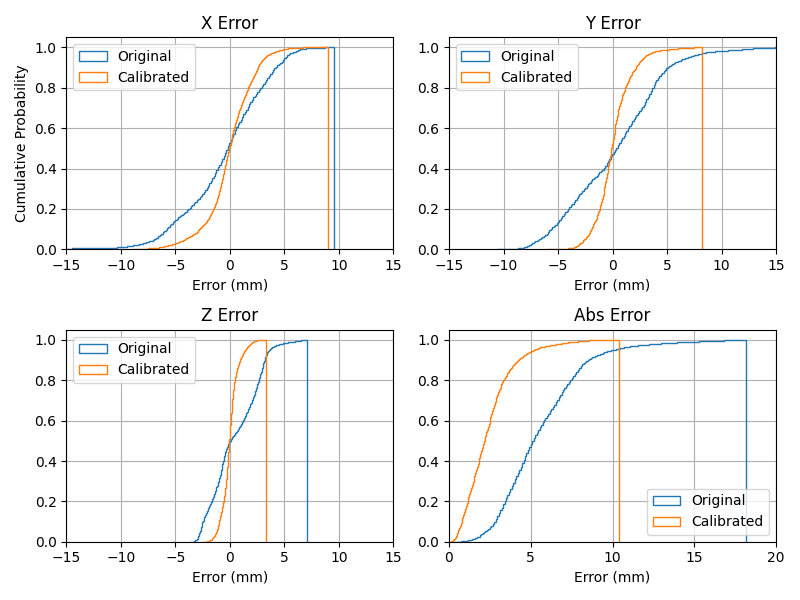

# Gantry Robot Error Analysis and Calibration

This directory contains Python scripts and utilities for analyzing and calibrating the gantry robot system. The system integrates OptiTrack motion capture data with gantry robot position data to perform error analysis and calibration.

**Important**: It is assumed that the gantry data is the commanded position of the gantry robot and the OptiTrack data is the actual position of the gantry robot.

The scripts apply the alignment and correction as follows:

- The **alignment** transforms the OptiTrack data to the coordinate system of the gantry.
- The **correction** is applied to the gantry data. The corrected gantry positions are then compared with the aligned OptiTrack positions.

The correction is applied to the gantry data because we are interested in the actual position of the gantry robot, and the correction model approximates it from the commanded position.

## System Overview

The system consists of several scripts to process and analyze the data:

1. **Raw Data Visualization**: `plot_movement_gantry.py` and `plot_movement_optitrack.py` scripts to visualize the raw gantry and OptiTrack data before calibration.
2. **Calibration**: `run_calibration.py` is the script that processes the raw data, performing the following steps:
   - **Alignment**: Temporal and spatial transformation of the OptiTrack data to the gantry coordinate system, using translation, rotation, and time shift transformations.
   - **Correction**: Polynomial transformation of the gantry data, which approximates the actual position of the gantry robot.

3. **Analysis**: Various scripts for plotting and analyzing the gantry and OptiTrack data, which can be executed after the calibration is complete:
   - `check_params.py`: Check the calibration parameters.
   - `check_inverse_kinematics.py`: Check the convergence of the inverse kinematics solver over the workspace.
   - `print_calibxyzkins_config.py`: Print the HAL configuration for the `calibxyzkins` module.
   - `plot_movement.py`: Visualize the gantry and OptiTrack path.
   - `plot_errors.py`: Plot positioning errors over time.
   - `plot_errors_scatter.py`: Plot positioning errors scatter plots.
   - `plot_errors_probability.py`: Plot positioning errors probability distributions.
   - `print_errors_summary.py`: Print a statistical summary of the positioning errors.
   - `plot_marker_errors.py`: Plot the OptiTrack marker residuals and the centroid error.
   - `plot_calibration_2d.py` and `plot_calibration_3d.py`: Plot the correction transformation.
   - `compare_correction_models.py`: Compare correction models with different terms.

4. **Clock drift**: Scripts to estimate the clock drift between the gantry and OptiTrack in the calibration measurement:
   - `estimate_calibration_clock_drift.py`: Estimate the time offset and the clock drift.
   - `calibration_clock_drift_impact.py`: Check the effect of a clock drift on the calibration.

5. **Validation with the RoboLoc-G dataset**: Scripts that apply the correction to the takes of the RoboLoc-G dataset, which were not used in the calibration:
   - `validate_dataset.py`: Compare the OptiTrack and gantry positions of the dataset, before and after the correction.
   - `plot_dataset_errors.py`: Plot the error between OptiTrack and the gantry over time for each take.
   - `estimate_dataset_clock_drift.py`: Estimate the clock drift between the gantry and OptiTrack in the dataset.

After the calibration is performed, the calibration parameters can be used to correct the gantry position data with the `calibxyzkins` module of LinuxCNC included in this repository.

## Calibration Process

The calibration process performs two steps: **alignment** and **correction**. The alignment is applied to the OptiTrack data and the correction to the gantry data.

### Step 1: Alignment

First, the OptiTrack data is transformed to the coordinate system of the gantry, to account for differences in coordinate systems and timing. This alignment process involves finding the following parameters:

- **Translation**: Shifts in X, Y, and Z axes
- **Rotation**: Rotations around X, Y, and Z axes. By default the rotation center is `(0, 0, 1500)`.
- **Time Shift**: Temporal alignment to account for timing differences.

The alignment parameters are found using numerical optimization with the `scipy.optimize.minimize` function (Powell method by default). The objective to minimize is selectable via the `objective` setting: the mean squared error (`mse`, the default) or the mean Euclidean distance (`mean_distance`) between the gantry and the aligned OptiTrack positions.

### Step 2: Correction

Analysis of scatter plots of the positioning errors (see "Plot Positioning Errors Scatter" section in Usage Examples below) reveals clear patterns in positioning errors:

- **Y-axis position affects errors in all axes**
- **X-axis position affects errors in the Y-axis**
- **Z-axis position affects errors in X and Y axes**

These systematic deviations can be modeled with a coordinate transformation of the gantry positions, which gives an approximation of the actual position of the gantry robot. For this we consider a polynomial transformation of degree $n$ without cross terms:

$$
\begin{bmatrix}
x' \\ y' \\ z'
\end{bmatrix} =
\mathbf{c} + \sum_{k=1}^{n} \mathbf{A}_k
\begin{bmatrix}
x^k \\ y^k \\ z^k
\end{bmatrix}
$$

where $x, y, z$ are the gantry position coordinates (the commanded position of the gantry robot), $x', y', z'$ are the corrected position coordinates (the actual position of the gantry robot), and $\mathbf{c}$ and $\mathbf{A}_1, \dots, \mathbf{A}_n$ are the vector and the $3 \times 3$ matrices that need to be optimized.

This transformation consists of:

1. Vector $\mathbf{c}$: Constant offset.
2. Matrix $\mathbf{A}_1$: Linear transformation that handles scaling, rotation, and shear.
3. Matrices $\mathbf{A}_2, \dots, \mathbf{A}_n$: Higher-order terms that correct non-linear distortions.

The highest power of each coordinate is set with the `degree` setting, which holds one value per coordinate, in the order $x, y, z$. The degree $n$ of the transformation is the largest of the three, and the column of $\mathbf{A}_k$ of a coordinate whose highest power is below $k$ is zero. The default is `[2, 2, 1]`, i.e., a second-order transformation in $x$ and $y$ that is linear in $z$:

$$
\begin{bmatrix}
x' \\ y' \\ z'
\end{bmatrix} =
\mathbf{c} +
\underbrace{
\begin{bmatrix}
a_{11} & a_{12} & a_{13} \\ a_{21} & a_{22} & a_{23} \\ a_{31} & a_{32} & a_{33}
\end{bmatrix}
}_{\normalsize \mathbf{A}_1}
\begin{bmatrix}
x \\ y \\ z
\end{bmatrix} +
\underbrace{
\begin{bmatrix}
b_{11} & b_{12} & 0 \\ b_{21} & b_{22} & 0 \\ b_{31} & b_{32} & 0
\end{bmatrix}
}_{\normalsize \mathbf{A}_2}
\begin{bmatrix}
x^2 \\ y^2 \\ z^2
\end{bmatrix}
$$

**Note**: The powers of $z$ above the first are left out by default because in our measurements the Z-axis only shows a linear distortion.

The correction parameters are found by minimizing the error between the corrected gantry positions and the aligned OptiTrack positions, with the objective selectable via the `objective` setting. Because the transformation is linear in $\mathbf{c}$ and $\mathbf{A}_k$, the mean squared error (`mse`, the default) is minimized with `numpy.linalg.lstsq`, while the mean Euclidean distance (`mean_distance`) is minimized iteratively with `scipy.optimize.minimize` (using the Powell method by default).

## Parameters Validation

The `calibxyzkins` module of LinuxCNC included in this repository uses the Newton-Raphson algorithm to solve the inverse kinematics problem: given desired axes positions $x', y', z'$, it finds the corresponding joint positions $x, y, z$ that satisfy the transformation equation:

$$\mathbf{f}(x, y, z) = \mathbf{c} + \sum_{k=1}^{n} \mathbf{A}_k \begin{bmatrix} x^k \\ y^k \\ z^k \end{bmatrix} = \begin{bmatrix} x' \\ y' \\ z' \end{bmatrix}$$

**Note**: The `calibxyzkins` module implements the transformation for degrees 1 to 5, set with its `degree` parameter. The `check_params.py` script accepts any degree.

To ensure the calibration parameters are valid we include the `check_params.py` script, which performs the following validation tests:

### 1. Jacobian Invertibility Test

The Newton-Raphson method requires computing the Jacobian matrix of the transformation function:

$$\mathbf{J} = \frac{\partial \mathbf{f}}{\partial [x, y, z]} = \sum_{k=1}^{n} k \cdot \mathbf{A}_k \cdot \text{diag}(x, y, z)^{k-1}$$

The Jacobian matrix must be invertible throughout the robot's workspace. This is tested using an approach based on the Neumann series.

The Neumann series states that $(\mathbf{I} - \mathbf{T})$ is invertible if $\|\mathbf{T}\| < 1$, where $\mathbf{I}$ is the identity matrix and $\|\cdot\|$ denotes a matrix norm.

For a matrix of the form $\mathbf{X} + \mathbf{Y} = \mathbf{X}(\mathbf{I} + \mathbf{X}^{-1}\mathbf{Y})$, the matrix has an inverse if $\|\mathbf{X}^{-1}\mathbf{Y}\| < 1$.

Applying this to our Jacobian:

- $\mathbf{X} = \mathbf{A}_1$
- $\mathbf{Y} = \sum_{k=2}^{n} k \cdot \mathbf{A}_k \cdot \text{diag}(x, y, z)^{k-1}$

Therefore, the Jacobian $\mathbf{J}$ is invertible if $\mathbf{A}_1$ is invertible and $\|\mathbf{A}_1^{-1} \mathbf{Y}\| < 1$ for every $x, y, z$ in the joint space bounds.

The entry in row $i$ and column $j$ of $\mathbf{A}_1^{-1} \mathbf{Y}$ depends only on the coordinate of column $j$, so its absolute value is at most $\sum_{k=2}^{n} k \cdot |[\mathbf{A}_1^{-1} \mathbf{A}_k]_{ij}| \cdot \hat{x}_j^{k-1}$, where $\hat{x}_j$ is the maximum absolute value of that coordinate in the joint space bounds. The `check_params.py` script computes the matrix of these bounds and checks that its 1-norm or its infinity-norm is below one, which is sufficient for the condition to hold.

### 2. Bounds Test

The coordinate transformation must respect the physical limits of the robot, i.e., the desired axes positions $(x', y', z')$ must be within the robot's axes limits, and the corresponding joint positions $(x, y, z)$ computed by the inverse kinematics must be within the robot's joint limits.

This condition is checked in the `check_params.py` script by finding the minimum and maximum values that each joint can reach when the axes positions are constrained to their limits. These values must fall within the specified joint limits of the robot for the parameters to be valid.

## Installation and Usage

1. **Install dependencies**: Use `uv` or `pip` to create a virtual environment and install the required Python packages.
   - With `uv`:

     ```bash
     uv venv && source .venv/bin/activate && uv pip install -r requirements.txt
     ```

   - With `pip`:

     ```bash
     python -m venv .venv && source .venv/bin/activate && pip install -r requirements.txt
     ```

2. **Prepare the data**: The system requires both gantry position data (CSV) and OptiTrack motion capture data (CSV) in the expected formats (see Data Format section below).

3. **Add a configuration file**: Create a `config.json` file with the calibration settings.

4. **Run the calibration script**: Execute the calibration script `run_calibration.py` to generate a `calibration.json` file with the alignment and correction parameters.

5. **Visualize the results**: Use the plotting scripts to visualize the results.

See the Usage Example section below for more details.

## Data Format

### Gantry Data (CSV)

The gantry data is a CSV file with the following columns:

- `time` - Unix time (seconds since 1970-01-01 00:00:00 UTC) as a floating-point number.
- `x`, `y`, `z` - Position coordinates in mm as floating-point numbers.

### OptiTrack Data (CSV)

The OptiTrack data is the CSV exported from the OptiTrack Motive software. The format follows this structure:

- **Line 1**: Header with metadata (format version, take name, capture frame rate, export frame rate, start time, total frames, rotation type, length units, coordinate space, etc.)
- **Line 2**: Blank line
- **Line 3**: Object types for each column (e.g., "Rigid Body", "Rigid Body Marker", "Marker")
- **Line 4**: Object names for each column (e.g., "Grua", "Grua:Marker1", "Active 1", "Unlabeled 1007")
- **Line 5**: Unique object IDs (hexadecimal identifiers for each marker/object)
- **Line 6**: Data types for each column ("Rotation" or "Position")
- **Line 7**: Column headers ("Frame", "Time (Seconds)", "X", "Y", "Z", "W" for quaternion rotation, then "X", "Y", "Z" for position coordinates)
- **Line 8 onwards**: Data rows containing:
  - Frame number (integer)
  - Time in seconds (floating-point)
  - Rotation and/or position coordinates.

**Note**: Missing or untracked data points appear as empty cells in the CSV.

## Usage Examples

We will use the measurement `2025-04-09` (located in `../measurements/2025-04-09/`) to explain the code functionality. By default the scripts use the files of this measurement (`take_gantry.csv`, `take_optitrack.csv`, `config.json`, and `calibration.json`). The default paths are defined in `defaults.py`.

To use the files of another measurement, specify them by command line arguments (run a script with `--help` to see its arguments).

The only exception is the `run_calibration.py` script, which writes the calibration file. By default, it looks for the files in the working directory (see the Run the calibration section below).

### Gantry and OptiTrack Path Visualization

The raw gantry and OptiTrack data can be visualized using the `plot_movement_gantry.py` and `plot_movement_optitrack.py` scripts, respectively. For example, to visualize the OptiTrack data, run:

```bash
python plot_movement_optitrack.py
```

It will open a window with the OptiTrack data visualization. The image below shows the OptiTrack data visualization.



You can use the keyboard to control the playback of the data. The available controls are shown when the script is executed:

```text
Animation Controls:
------------------
Space: Play/Pause
PageUp/PageDown: Increase/Decrease playback speed
Shift + PageUp/PageDown: Increase/Decrease playback speed by 5x
m/n: Step forward/backward 1 frame
M/N: Step forward/backward 60 frames
Ctrl+m/Ctrl+n: Step forward/backward 600 frames
i/o: Jump to start/end
```

### Calibration Configuration

Before running the calibration script, you need to create a JSON configuration file, by default named `config.json`. The configuration file defines the calibration parameters, data processing options, and analysis settings. The configuration format follows the structure defined in the `CalibrationConfig` class in `data.py`, allowing you to customize:

- Alignment parameters, objective, and `minimize_options` settings
- Correction parameters, objective, and `minimize_options` settings
- Frame skipping ranges for excluding poor tracking data

The contents of the configuration file used for the `2025-04-09` measurement are the following:

```json
{
  "alignment": {
    "init_params": [50, 0, 0, -1.5707963267948966, 2500, 2500, -2500],
    "max_rotation": null,
    "rotation_center": [0, 0, 1500],
    "objective": "mse",
    "minimize_options": {
      "method": "Powell",
      "tolerance": 1e-9,
      "display": true
    }
  },
  "correction": {
    "enabled": true,
    "degree": [3, 3, 1],
    "objective": "mse",
    "minimize_options": {
      "method": "Powell",
      "tolerance": 1e-9,
      "display": true
    },
    "reject_samples": {
      "enabled": true,
      "sigma": 5.0,
      "margin_s": 0.25,
      "iterations": 2
    },
    "skip_samples": {
      "enabled": true,
      "ranges": [
        [0, 3500]
      ]
    }
  }
}
```

Some important considerations:

- The initialization parameters in the `init_params` field of the `alignment` section are the initial values for the optimization of the calibration alignment step. If not specified, default values of 0 are used. The parameters are the following, in the order they are used in the optimization (see the `coord_align` function in `data.py`):

  - `time_shift`: Time shift in seconds
  - `x_rotation`: Rotation around the x-axis in radians
  - `y_rotation`: Rotation around the y-axis in radians
  - `z_rotation`: Rotation around the z-axis in radians
  - `x_shift`: Translation along the x-axis in mm
  - `y_shift`: Translation along the y-axis in mm
  - `z_shift`: Translation along the z-axis in mm

  Important: These parameters may be needed to be set manually for the optimization to converge to the optimal value.

- The `max_rotation` parameter is the maximum rotation, in radians, that the optimization can apply around each axis from its initial value. If not specified, $\pi/32$ is used. With `null` the rotations are not limited. If the rotations are not limited or the value is too large, the optimization may not converge to the optimal value.

- The `degree` parameter of the `correction` section is the highest power of the x, y, and z coordinates in the correction transformation (see the Correction step above). If not specified, `[2, 2, 1]` is used. The same degree is used to reject samples.

- The `reject_samples` section of the `correction` discards the samples in which OptiTrack did not track the rigid body properly, whose recorded position is therefore wrong. They are found through the residual of the correction model: the model is fitted, and every sample whose 3D residual exceeds `sigma` robust standard deviations from the median is rejected, together with the `margin_s` seconds on either side of it, which covers the ramps at the edges of a dropout. The fit is then repeated, `iterations` times in total.

  The spread is measured with the [median absolute deviation](https://en.wikipedia.org/wiki/Median_absolute_deviation) rather than with the standard deviation, because the standard deviation is itself inflated by the very samples we are looking for, which raises the threshold until they pass it. The MAD is scaled by 1.4826 so that it matches the standard deviation for Gaussian data and `sigma` keeps its usual meaning.

- The `skip_samples` section of the `correction` is a list of sample ranges to exclude by hand, given as tuples with the first and last index of each range. It is superseded by `reject_samples` and disabled by default, and remains for captures that need a specific interval out. In the `2025-04-09` measurement it excludes the samples 0 to 3500.

- Samples removed by either mechanism are dropped from the returned data as well, so the statistics and the figures are computed over the same samples as the fit.

### Run the calibration

To execute the calibration execute the `run_calibration.py` script from the measurement directory:

```bash
cd ../measurements/2025-04-09/
python ../../src/run_calibration.py
```

By default, `run_calibration.py` reads the data and configuration files from the working directory and saves the alignment and correction parameters in a `calibration.json` file in the working directory. If the calibration file already exists, the script asks for confirmation before running the calibration again.

The calibration file holds the alignment parameters and the correction parameters. The former are the time shift `time_offset`, in seconds, the `rotation` angles about the x, y and z axes, in radians, and the `translation`, in millimeters. The latter are the vector `c` and the list `A` of the matrices of the correction transformation, one per power, so the degree of the transformation is the number of matrices.

The contents of the calibration file used for the `2025-04-09` measurement are the following:

```json
{
  "alignment": {
    "time_offset": 48.52745729893273,
    "rotation": [
      0.016175827507814915,
      0.0018425560471000747,
      -1.6280108533762478
    ],
    "translation": [
      2431.9697236070406,
      2435.007362734755,
      -2447.4246000168782
    ]
  },
  "correction": {
    "c": [
      8.468704217520418,
      2.221450462543982,
      3.838348453280993
    ],
    "A": [
      [
        [
          1.0045314403390107,
          0.0006060826903485233,
          0.011902603108565763
        ],
        [
          -0.004710142890022349,
          1.001237522104381,
          0.003901566714995413
        ],
        [
          0.0014726403070209617,
          -0.005976848923450272,
          1.0001358908134088
        ]
      ],
      [
        [
          -2.2856715856574925e-6,
          4.970608098239568e-7,
          0.0
        ],
        [
          1.3732389138206606e-6,
          6.381111397460615e-7,
          0.0
        ],
        [
          -9.169289143547495e-7,
          1.4606115453310274e-6,
          0.0
        ]
      ],
      [
        [
          3.0884395617449264e-10,
          -1.726905932853275e-10,
          0.0
        ],
        [
          -1.3106979866943501e-10,
          -9.46137460273178e-11,
          0.0
        ],
        [
          1.405389173564769e-10,
          -5.94146825492022e-11,
          0.0
        ]
      ]
    ]
  }
}
```

### Run the parameters validation

The `check_params.py` script is used to validate the calibration parameters. As explained in the Parameters Validation section, it performs a Jacobian invertibility test and a bounds test.

To run the validation execute the `check_params.py` script:

```bash
python check_params.py
```

The script accepts the following parameters to customize the joints and axes bounds:

- `--axis-min`: The minimum value of the X, Y, and Z axes.
- `--axis-max`: The maximum value of the X, Y, and Z axes.
- `--joints-min`: The minimum value of the X, Y, and Z joints.
- `--joints-max`: The maximum value of the X, Y, and Z joints.

### LinuxCNC Configuration for the `calibxyzkins` module

The `calibxyzkins` module included in this repository can be used to calibrate the gantry robot with the correction parameters obtained from the calibration process. To use the module, its HAL parameters must be set properly. These parameters can be generated using the `print_calibxyzkins_config.py` script:

```bash
python print_calibxyzkins_config.py
```

The script outputs the HAL parameters of the calibration matrices $\mathbf{A}_1$ to $\mathbf{A}_n$ and of the vector $\mathbf{c}$, with $n$ the degree of the correction model of the calibration file. The module creates the parameters of the matrices up to the degree given by its `degree` parameter, so it must be loaded with the degree of the correction model (for example, `loadrt calibxyzkins coordinates=xyyz degree=3`). The module implements the transformation up to degree 5. For the calibration file of the `2025-04-09` measurement, of degree three, it outputs the following HAL configuration:

```text
# The calibxyzkins module must be loaded with degree=3

# Calibration matrix A1
setp calibxyzkins.calib-a1.xx 1.00453144
setp calibxyzkins.calib-a1.xy 0.0006060829668
setp calibxyzkins.calib-a1.xz 0.01190260298
setp calibxyzkins.calib-a1.yx -0.004710143219
setp calibxyzkins.calib-a1.yy 1.001237522
setp calibxyzkins.calib-a1.yz 0.003901566711
setp calibxyzkins.calib-a1.zx 0.001472640288
setp calibxyzkins.calib-a1.zy -0.00597684889
setp calibxyzkins.calib-a1.zz 1.000135891

# Calibration matrix A2
setp calibxyzkins.calib-a2.xx -2.285671595e-06
setp calibxyzkins.calib-a2.xy 4.970607672e-07
setp calibxyzkins.calib-a2.xz 0
setp calibxyzkins.calib-a2.yx 1.373238973e-06
setp calibxyzkins.calib-a2.yy 6.381111199e-07
setp calibxyzkins.calib-a2.yz 0
setp calibxyzkins.calib-a2.zx -9.16928908e-07
setp calibxyzkins.calib-a2.zy 1.460611551e-06
setp calibxyzkins.calib-a2.zz 0

# Calibration matrix A3
setp calibxyzkins.calib-a3.xx 3.088439582e-10
setp calibxyzkins.calib-a3.xy -1.726905844e-10
setp calibxyzkins.calib-a3.xz 0
setp calibxyzkins.calib-a3.yx -1.310698088e-10
setp calibxyzkins.calib-a3.yy -9.461374443e-11
setp calibxyzkins.calib-a3.yz 0
setp calibxyzkins.calib-a3.zx 1.405389167e-10
setp calibxyzkins.calib-a3.zy -5.941468316e-11
setp calibxyzkins.calib-a3.zz 0

# Calibration vector c
setp calibxyzkins.calib-c.x 8.468703477
setp calibxyzkins.calib-c.y 2.221451156
setp calibxyzkins.calib-c.z 3.838348357
```

### Corrected Gantry and OptiTrack Path Visualization

The corrected gantry path and the aligned OptiTrack path can be visualized using the `plot_movement.py` script:

```bash
python plot_movement.py
```

Note that the script accepts the `--no-correct` flag to show the gantry position without applying the correction transformation.

The image below shows the corrected gantry and OptiTrack path visualization.



As in the case of the raw data visualization scripts, you can use the keyboard to control the playback of the data. The available controls are shown when the script is executed:

```text
Animation Controls:
------------------
Space: Play/Pause
PageUp/PageDown: Increase/Decrease playback speed
Shift + PageUp/PageDown: Increase/Decrease playback speed by 5x
m/n: Step forward/backward 1 frame
M/N: Step forward/backward 60 frames
Ctrl+m/Ctrl+n: Step forward/backward 600 frames
i/o: Jump to start/end
```

### Plot Positioning Errors Over Time

The positioning errors between gantry and OptiTrack data over time can be plotted using the `plot_errors.py` script:

```bash
python plot_errors.py
```

The script accepts the option `--time-unit` to specify the time unit of the x-axis. The available options are `s` (seconds) and `frames`. The default is `s` (seconds). The `frames` options can be used to check the ranges of frames with poor tracking quality, then they can be skipped by setting them in the configuration file.

The script also accepts the `--no-correct` flag to show the errors without applying the correction transformation to the gantry position.

The image below shows the positioning errors over time with the `--no-correct` flag, i.e., without applying the correction transformation to the gantry position.



The image below shows the positioning errors over time when applying the correction transformation to the gantry position.



### Plot Positioning Errors Scatter

Positioning errors scatter plots between gantry and OptiTrack data can be plotted using the `plot_errors_scatter.py` script:

```bash
python plot_errors_scatter.py
```

The script also accepts the `--no-correct` flag to show the errors without applying the correction transformation to the gantry position.

The image below shows the positioning errors scatter plots with the `--no-correct` flag, i.e., without applying the correction transformation to the gantry position.



The image below shows the positioning errors scatter plots when applying the correction transformation to the gantry position.



### Plot Positioning Errors Probability Distributions

The positioning errors probability distribution can be plotted using the `plot_errors_probability.py` script:

```bash
python plot_errors_probability.py
```

By default the script plots the probability distribution of the positioning errors for the x, y, and z axes. The image below shows the obtained probability distributions.



The script accepts the `--cumulative` flag to plot the cumulative distribution function of the positioning errors. The image below shows the cumulative distribution function of the positioning errors for the x, y, and z axes.



## License

See the LICENSE file for details.
